

<a href="prompts/landing-pages/blockhaus">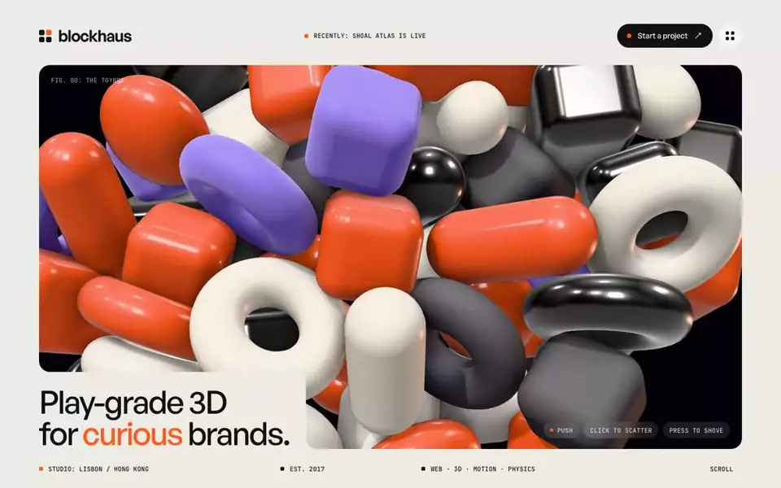</a>

# Free Website Prompts

**30 build prompts for animated, cinematic websites. Paste one into Claude Code, Cursor or Codex and you get the site.**

Every one is free, and every preview below is a screen recording of the real build.

[**Browse all 302 on vividsites →**](https://www.vividsites.app/?utm_source=github&utm_medium=free-prompts&utm_campaign=hero)

## How to use one

1. Pick a site below and open its folder.
2. Open `prompt.md` and press **Copy raw file** (the copy icon at the top right of the file).
3. Paste it into Claude Code, Cursor or Codex in an empty folder and let it build.

You don't need to generate anything. The videos and images each site uses are already hosted, and the prompt links to them. Many build a single `index.html` with no build step. The React ones say so in their first line.

## New: Blockhaus is free

<table>
<tr>
<td width="58%"></td>
<td width="42%" valign="top">

### [Blockhaus](prompts/landing-pages/blockhaus)

**Landing Page · Interactive 3D Studio**

A 3D studio site that opens on a live physics pile of 62 glossy toy blocks. Your cursor shoves them, a click bursts them apart, a paper ribbon draws across the page, a showreel grows to full window, and the toys stack into a little house that floods orange into the footer.

Three renderers, a hand-written physics solver, and nothing to install: one HTML file.

[**Live demo**](https://www.vividsites.app/api/preview/blockhaus/index.html) · [**prompt.md**](prompts/landing-pages/blockhaus/prompt.md)

</td>
</tr>
</table>

## Landing pages

Whole pages: loader, hero, sections, footer.

<table>
<tr>
<td width="50%" valign="top">
<a href="prompts/landing-pages/orrery">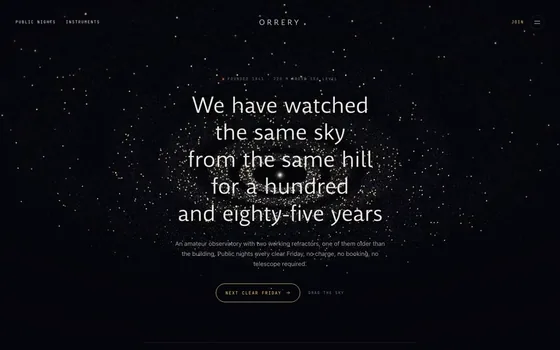</a>
 <a href="prompts/landing-pages/orrery"><b>Orrery</b></a> · Observatory
 HTML · WebGL2 · Particles
</td>
<td width="50%" valign="top">
<a href="prompts/landing-pages/brandnewday">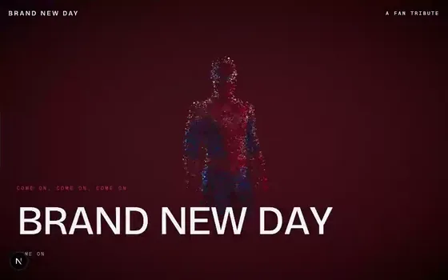</a>
 <a href="prompts/landing-pages/brandnewday"><b>Brand New Day</b></a> · Scroll Film
 React · Three.js · Scroll Film
</td>
</tr>
<tr>
<td width="50%" valign="top">
<a href="prompts/landing-pages/graven">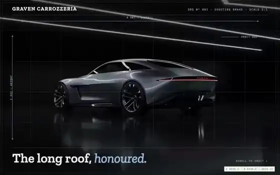</a>
 <a href="prompts/landing-pages/graven"><b>Graven</b></a> · Blueprint Sheet
 React · Tailwind · Scroll
</td>
<td width="50%" valign="top">
<a href="prompts/landing-pages/ascent">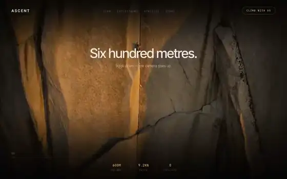</a>
 <a href="prompts/landing-pages/ascent"><b>Ascent</b></a> · Alpine
 HTML · CSS · Scroll-Scrub
</td>
</tr>
<tr>
<td width="50%" valign="top">
<a href="prompts/landing-pages/chalk">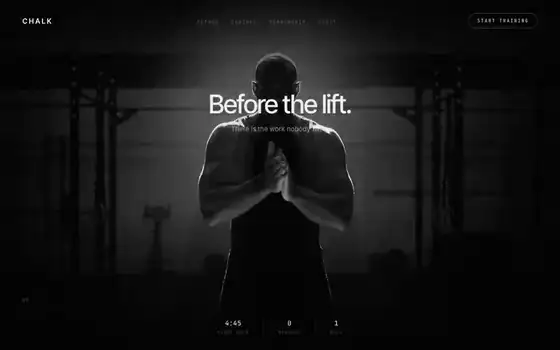</a>
 <a href="prompts/landing-pages/chalk"><b>Chalk</b></a> · Strength
 HTML · CSS · Scroll-Scrub
</td>
<td width="50%" valign="top">
<a href="prompts/landing-pages/prisma">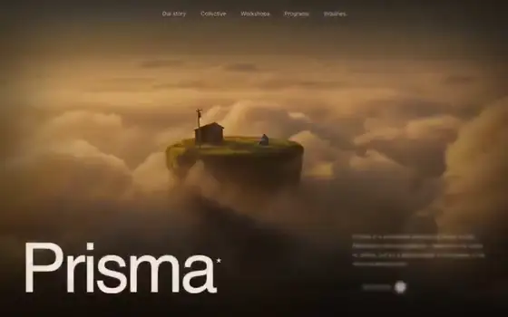</a>
 <a href="prompts/landing-pages/prisma"><b>Prisma</b></a> · Creative Collective
 HTML · CSS · Scroll
</td>
</tr>
</table>

## Hero sections

One full screen that you can ship alone or put on top of a page you already have.

<table>
<tr>
<td width="33%" valign="top">
<a href="prompts/hero-sections/deepfield">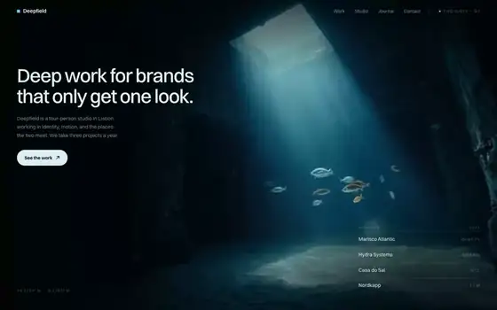</a>
 <a href="prompts/hero-sections/deepfield"><b>Deepfield</b></a> · Creative Studio
 HTML · CSS · One Screen
</td>
<td width="33%" valign="top">
<a href="prompts/hero-sections/solstice">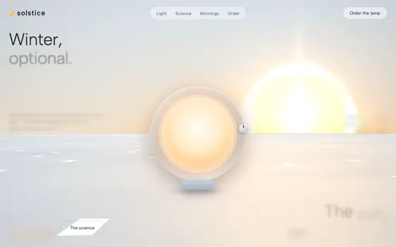</a>
 <a href="prompts/hero-sections/solstice"><b>Solstice</b></a> · Light Therapy Lamp
 HTML · WebGL2 · Halo Optics
</td>
<td width="33%" valign="top">
<a href="prompts/hero-sections/koi">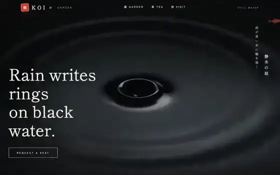</a>
 <a href="prompts/hero-sections/koi"><b>Koi Garden</b></a> · Teahouse
 React · Tailwind
</td>
</tr>
<tr>
<td width="33%" valign="top">
<a href="prompts/hero-sections/hourglass">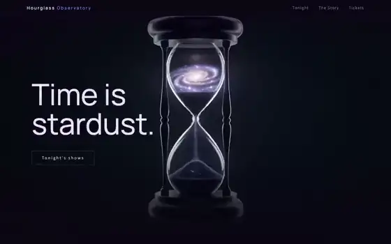</a>
 <a href="prompts/hero-sections/hourglass"><b>Hourglass</b></a> · Planetarium
 React · Tailwind
</td>
<td width="33%" valign="top">
<a href="prompts/hero-sections/plume">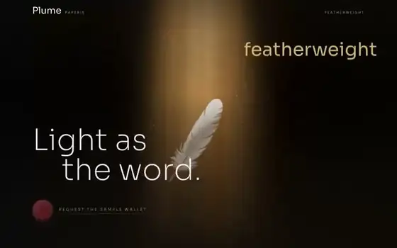</a>
 <a href="prompts/hero-sections/plume"><b>Plume</b></a> · Paperie
 React · Tailwind
</td>
<td width="33%" valign="top">
<a href="prompts/hero-sections/sonor">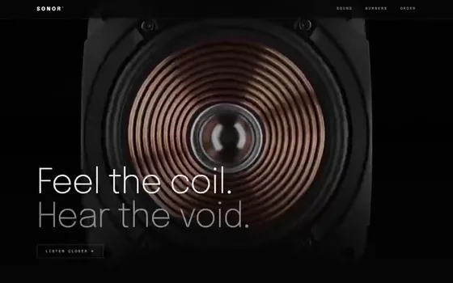</a>
 <a href="prompts/hero-sections/sonor"><b>Sonor</b></a> · Audio Lab
 React · Tailwind
</td>
</tr>
<tr>
<td width="33%" valign="top">
<a href="prompts/hero-sections/verdant">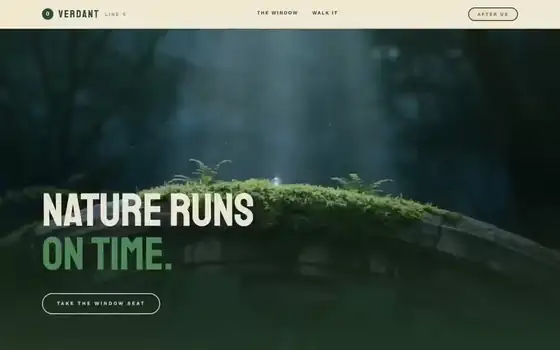</a>
 <a href="prompts/hero-sections/verdant"><b>Verdant</b></a> · Overgrown Metro
 React · Tailwind
</td>
<td width="33%" valign="top">
<a href="prompts/hero-sections/sub2">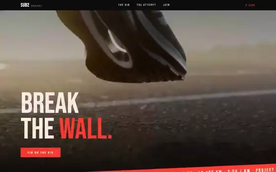</a>
 <a href="prompts/hero-sections/sub2"><b>Sub2</b></a> · Race Campaign
 React · Tailwind
</td>
<td width="33%" valign="top">
<a href="prompts/hero-sections/knead">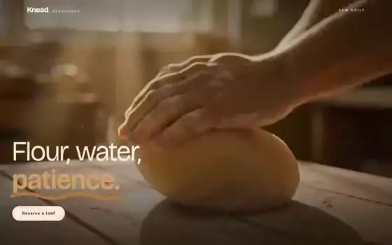</a>
 <a href="prompts/hero-sections/knead"><b>Knead</b></a> · Bakehouse
 React · Tailwind
</td>
</tr>
<tr>
<td width="33%" valign="top">
<a href="prompts/hero-sections/cinematic">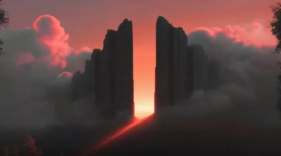</a>
 <a href="prompts/hero-sections/cinematic"><b>Cinematic Hero</b></a> · Movie / Streaming
 React · Tailwind · Lucide
</td>
<td width="33%" valign="top">
<a href="prompts/hero-sections/frost">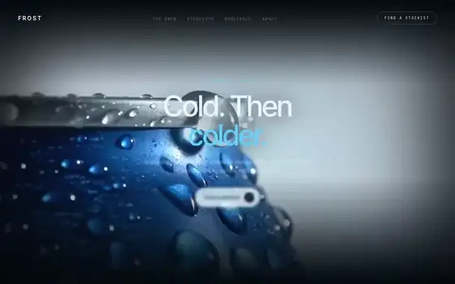</a>
 <a href="prompts/hero-sections/frost"><b>Frost</b></a> · Cold Brew
 HTML · CSS
</td>
<td width="33%" valign="top">
<a href="prompts/hero-sections/stillwater">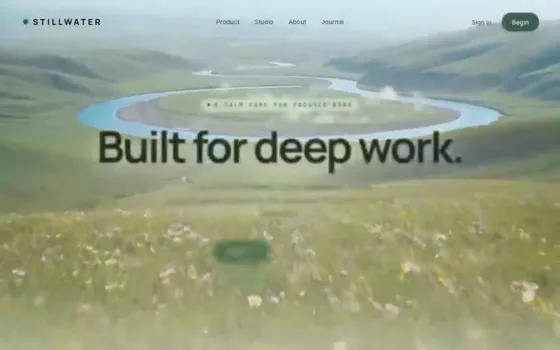</a>
 <a href="prompts/hero-sections/stillwater"><b>Stillwater</b></a> · Deep Work
 React · Tailwind
</td>
</tr>
<tr>
<td width="33%" valign="top">
<a href="prompts/hero-sections/rove">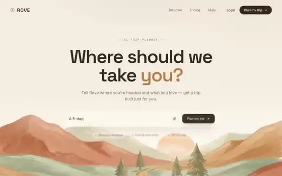</a>
 <a href="prompts/hero-sections/rove"><b>Rove</b></a> · Travel AI
 React · Tailwind
</td>
<td width="33%" valign="top">
<a href="prompts/hero-sections/ascend">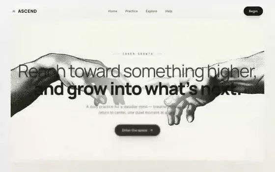</a>
 <a href="prompts/hero-sections/ascend"><b>Ascend</b></a> · Mindfulness
 React · Tailwind
</td>
<td width="33%" valign="top">
<a href="prompts/hero-sections/haven">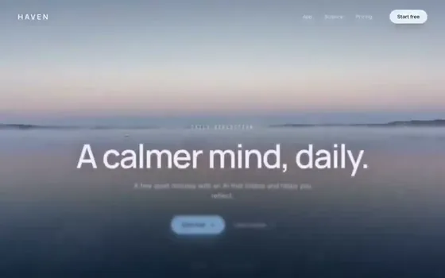</a>
 <a href="prompts/hero-sections/haven"><b>Haven</b></a> · Wellness AI
 React · Tailwind
</td>
</tr>
<tr>
<td width="33%" valign="top">
<a href="prompts/hero-sections/terra">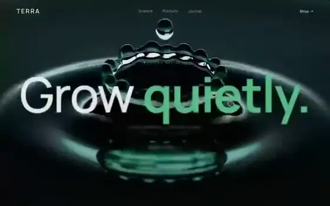</a>
 <a href="prompts/hero-sections/terra"><b>Terra</b></a> · Wellness
 React · Tailwind
</td>
<td width="33%" valign="top">
<a href="prompts/hero-sections/drift">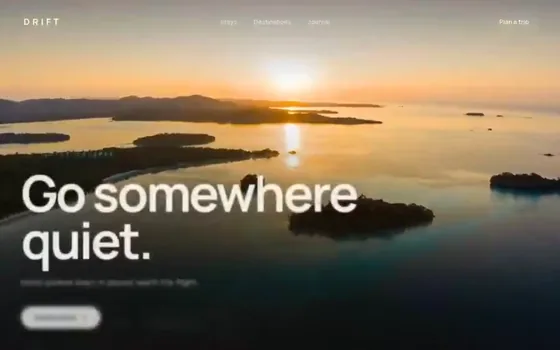</a>
 <a href="prompts/hero-sections/drift"><b>Drift</b></a> · Travel
 React · Tailwind
</td>
<td width="33%" valign="top">
<a href="prompts/hero-sections/flux">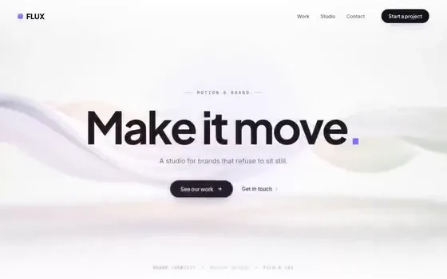</a>
 <a href="prompts/hero-sections/flux"><b>Flux</b></a> · Creative Studio
 React · Tailwind
</td>
</tr>
<tr>
<td width="33%" valign="top">
<a href="prompts/hero-sections/helio">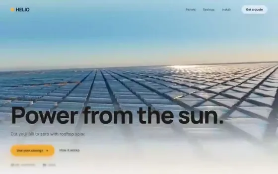</a>
 <a href="prompts/hero-sections/helio"><b>Helio</b></a> · Solar Energy
 React · Tailwind
</td>
<td width="33%"></td>
<td width="33%"></td>
</tr>
</table>

## 3D and interactive

Single pieces driven by the cursor, plus drop-in WebGL backgrounds.

<table>
<tr>
<td width="33%" valign="top">
<a href="prompts/3d-and-interactive/strato">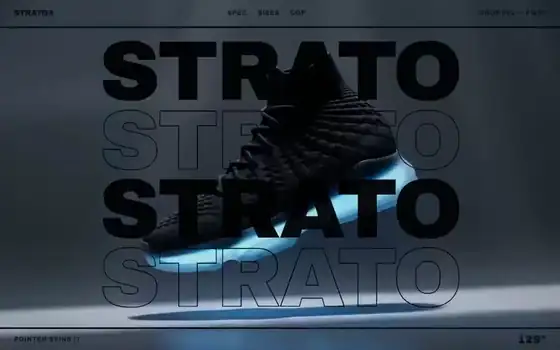</a>
 <a href="prompts/3d-and-interactive/strato"><b>Strato</b></a> · Sneaker Drop
 React · Tailwind · Cursor
</td>
<td width="33%" valign="top">
<a href="prompts/3d-and-interactive/morpho">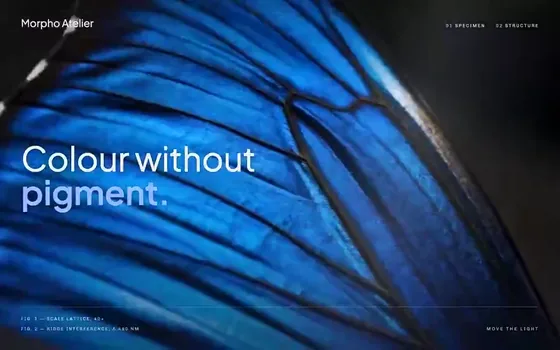</a>
 <a href="prompts/3d-and-interactive/morpho"><b>Morpho</b></a> · Field Journal
 React · Tailwind · Cursor
</td>
<td width="33%" valign="top">

 <a href="prompts/3d-and-interactive/lattice"><b>Lattice</b></a> · Perspective Grid
 HTML · WebGL2 · Shader
</td>
</tr>
<tr>
<td width="33%" valign="top">
<a href="prompts/3d-and-interactive/halftone">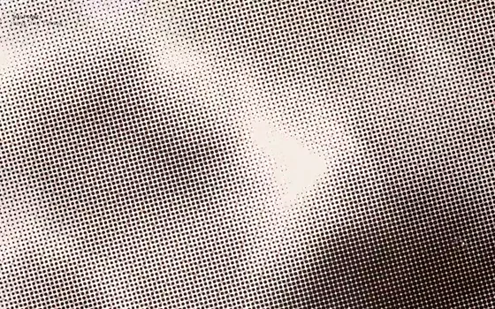</a>
 <a href="prompts/3d-and-interactive/halftone"><b>Halftone</b></a> · Print Screen
 HTML · WebGL2 · Shader
</td>
<td width="33%"></td>
<td width="33%"></td>
</tr>
</table>

## Want the rest?

<table>
<tr>
<td>

### [vividsites Pro →](https://www.vividsites.app/pricing?utm_source=github&utm_medium=free-prompts&utm_campaign=pro)

These 30 are the free shelf. The full library has **302 sites**: long-scroll three.js films, generated 3D products, scroll-scrubbed fly-throughs, and the newest builds the week they ship. Every one is a single prompt like the ones here.

**[Unlock the full library →](https://www.vividsites.app/pricing?utm_source=github&utm_medium=free-prompts&utm_campaign=pro)**

</td>
</tr>
</table>

## More free stuff

- **[Free components](https://www.vividsites.app/components?utm_source=github&utm_medium=free-prompts&utm_campaign=components)**: single UI and 3D pieces with code you can paste.
- **[Free backgrounds](https://www.vividsites.app/?utm_source=github&utm_medium=free-prompts&utm_campaign=backgrounds)**: Lavender Lake, Chrome Flux, Glass Wave, as 1080p loops.
- **[vividui](https://github.com/micahc123/vividui)**: WebGL backgrounds, three.js scenes and elements, each one a self-contained HTML file.
- **[vividsites MCP](https://www.vividsites.app/mcp?utm_source=github&utm_medium=free-prompts&utm_campaign=mcp)**: search the whole library and pull prompts from inside Claude.

## Every prompt

| Site | Type | Theme | Stack | |
|---|---|---|---|---|
| [Blockhaus](prompts/landing-pages/blockhaus) | Landing Page | Interactive 3D Studio | HTML, Three.js, Live Toy Physics | [prompt](prompts/landing-pages/blockhaus/prompt.md) |
| [Orrery](prompts/landing-pages/orrery) | Landing Page | Observatory | HTML, WebGL2, Particles | [prompt](prompts/landing-pages/orrery/prompt.md) |
| [Brand New Day](prompts/landing-pages/brandnewday) | Landing Page | Scroll Film | React, Three.js, Scroll Film | [prompt](prompts/landing-pages/brandnewday/prompt.md) |
| [Graven](prompts/landing-pages/graven) | Landing Page | Blueprint Sheet | React, Tailwind, Scroll | [prompt](prompts/landing-pages/graven/prompt.md) |
| [Ascent](prompts/landing-pages/ascent) | Landing Page | Alpine | HTML, CSS, Scroll-Scrub | [prompt](prompts/landing-pages/ascent/prompt.md) |
| [Chalk](prompts/landing-pages/chalk) | Landing Page | Strength | HTML, CSS, Scroll-Scrub | [prompt](prompts/landing-pages/chalk/prompt.md) |
| [Prisma](prompts/landing-pages/prisma) | Landing Page | Creative Collective | HTML, CSS, Scroll | [prompt](prompts/landing-pages/prisma/prompt.md) |
| [Deepfield](prompts/hero-sections/deepfield) | Hero Section | Creative Studio | HTML, CSS, One Screen | [prompt](prompts/hero-sections/deepfield/prompt.md) |
| [Solstice](prompts/hero-sections/solstice) | Hero Section | Light Therapy Lamp | HTML, WebGL2, Halo Optics | [prompt](prompts/hero-sections/solstice/prompt.md) |
| [Koi Garden](prompts/hero-sections/koi) | Hero Section | Teahouse | React, Tailwind | [prompt](prompts/hero-sections/koi/prompt.md) |
| [Hourglass](prompts/hero-sections/hourglass) | Hero Section | Planetarium | React, Tailwind | [prompt](prompts/hero-sections/hourglass/prompt.md) |
| [Plume](prompts/hero-sections/plume) | Hero Section | Paperie | React, Tailwind | [prompt](prompts/hero-sections/plume/prompt.md) |
| [Sonor](prompts/hero-sections/sonor) | Hero Section | Audio Lab | React, Tailwind | [prompt](prompts/hero-sections/sonor/prompt.md) |
| [Verdant](prompts/hero-sections/verdant) | Hero Section | Overgrown Metro | React, Tailwind | [prompt](prompts/hero-sections/verdant/prompt.md) |
| [Sub2](prompts/hero-sections/sub2) | Hero Section | Race Campaign | React, Tailwind | [prompt](prompts/hero-sections/sub2/prompt.md) |
| [Knead](prompts/hero-sections/knead) | Hero Section | Bakehouse | React, Tailwind | [prompt](prompts/hero-sections/knead/prompt.md) |
| [Cinematic Hero](prompts/hero-sections/cinematic) | Hero Section | Movie / Streaming | React, Tailwind, Lucide | [prompt](prompts/hero-sections/cinematic/prompt.md) |
| [Frost](prompts/hero-sections/frost) | Hero Section | Cold Brew | HTML, CSS | [prompt](prompts/hero-sections/frost/prompt.md) |
| [Stillwater](prompts/hero-sections/stillwater) | Hero Section | Deep Work | React, Tailwind | [prompt](prompts/hero-sections/stillwater/prompt.md) |
| [Rove](prompts/hero-sections/rove) | Hero Section | Travel AI | React, Tailwind | [prompt](prompts/hero-sections/rove/prompt.md) |
| [Ascend](prompts/hero-sections/ascend) | Hero Section | Mindfulness | React, Tailwind | [prompt](prompts/hero-sections/ascend/prompt.md) |
| [Haven](prompts/hero-sections/haven) | Hero Section | Wellness AI | React, Tailwind | [prompt](prompts/hero-sections/haven/prompt.md) |
| [Terra](prompts/hero-sections/terra) | Hero Section | Wellness | React, Tailwind | [prompt](prompts/hero-sections/terra/prompt.md) |
| [Drift](prompts/hero-sections/drift) | Hero Section | Travel | React, Tailwind | [prompt](prompts/hero-sections/drift/prompt.md) |
| [Flux](prompts/hero-sections/flux) | Hero Section | Creative Studio | React, Tailwind | [prompt](prompts/hero-sections/flux/prompt.md) |
| [Helio](prompts/hero-sections/helio) | Hero Section | Solar Energy | React, Tailwind | [prompt](prompts/hero-sections/helio/prompt.md) |
| [Strato](prompts/3d-and-interactive/strato) | 3D Section | Sneaker Drop | React, Tailwind, Cursor | [prompt](prompts/3d-and-interactive/strato/prompt.md) |
| [Morpho](prompts/3d-and-interactive/morpho) | 3D Section | Field Journal | React, Tailwind, Cursor | [prompt](prompts/3d-and-interactive/morpho/prompt.md) |
| [Lattice](prompts/3d-and-interactive/lattice) | 3D Section | Perspective Grid | HTML, WebGL2, Shader | [prompt](prompts/3d-and-interactive/lattice/prompt.md) |
| [Halftone](prompts/3d-and-interactive/halftone) | 3D Section | Print Screen | HTML, WebGL2, Shader | [prompt](prompts/3d-and-interactive/halftone/prompt.md) |

There is a machine-readable index in [`catalog.json`](catalog.json).

## Tips

- **Paste the whole prompt.** It is long on purpose, because the exact fonts, timings and easing are what make a site look designed.
- **Use a strong model.** They work best with a frontier model such as Claude Opus. Smaller models skip details.
- **Change the brand, keep the structure.** Ask your agent to swap the name, copy and colours once the site is built.
- **Check it on a phone.** If something looks wrong at 390px wide, tell your agent what you see.

## License

You can use these prompts to build sites for yourself or for clients, commercial work included. Please don't repackage or resell the prompts themselves. See [LICENSE](LICENSE.md).

Made by [vividsites](https://www.vividsites.app/?utm_source=github&utm_medium=free-prompts&utm_campaign=footer). If this saved you a day, a ⭐ helps other people find it.

