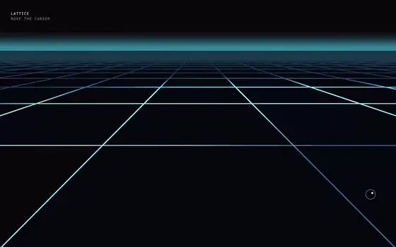

# Lattice

**3D Section · Perspective Grid** · HTML · WebGL2 · Shader

A drop-in WebGL perspective grid. The cursor ring travels along the plane instead of sliding over it.

[See it on vividsites](https://www.vividsites.app/t/lattice?utm_source=github&utm_medium=free-prompts&utm_campaign=lattice) · [**prompt.md**](prompt.md)

## Use it

1. Open [`prompt.md`](prompt.md) and press **Copy raw file** (the copy icon at the top right of the file).
2. Open an empty folder in Claude Code, Cursor or Codex.
3. Paste the prompt and let it build. Any video or image the site needs is already hosted, and the prompt links to it.

The prompt is about 12k characters. It is long because it pins the type, timing and motion that make the site look right. Paste the whole thing.

---

This is one of 30 free prompts. **[vividsites Pro](https://www.vividsites.app/pricing?utm_source=github&utm_medium=free-prompts&utm_campaign=pro)** unlocks the other 272.

[← All free prompts](../../../README.md)
