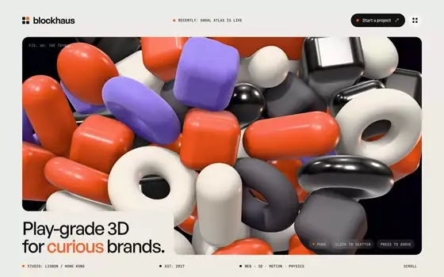

# Blockhaus

**Landing Page · Interactive 3D Studio** · HTML · Three.js · Live Toy Physics

A 3D studio site that opens on a live physics pile of 62 glossy toy blocks. Your cursor shoves them, a click bursts them apart, a paper ribbon draws across the page, a showreel grows to full window, and the toys stack into a little house that floods orange into the footer.

[**Live demo**](https://www.vividsites.app/api/preview/blockhaus/index.html) · [See it on vividsites](https://www.vividsites.app/t/blockhaus?utm_source=github&utm_medium=free-prompts&utm_campaign=blockhaus) · [**prompt.md**](prompt.md)

## Use it

1. Open [`prompt.md`](prompt.md) and press **Copy raw file** (the copy icon at the top right of the file).
2. Open an empty folder in Claude Code, Cursor or Codex.
3. Paste the prompt and let it build. Any video or image the site needs is already hosted, and the prompt links to it.

The prompt is about 118k characters. It is long because it pins the type, timing and motion that make the site look right. Paste the whole thing.

---

This is one of 31 free prompts. **[vividsites Pro](https://www.vividsites.app/pricing?utm_source=github&utm_medium=free-prompts&utm_campaign=pro)** unlocks the other 299.

[← All free prompts](../../../README.md)
