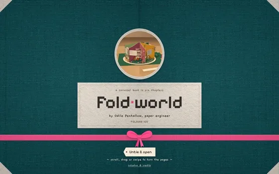

# Foldworld

**Template · Pop-Up Portfolio** · HTML · Three.js · Extruded Paper Props

The carousel pop-up book of a fictional paper engineer, laid open on a craft table as one live paper diorama. A teal cloth cover tied with a pink ribbon shows the book turning through a round die-cut window; untie it and the boards swing open like doors as the camera flies down into the first of six colour-blocked rooms. Scroll, drag or swipe to turn it chapter by chapter while hanging gulls and lanterns swing with the turn. Every cut-out prop has card thickness, wiggles under your cursor, hops when clicked and can unfold a paper card with its story. Built in HTML and Three.js, one file, no build step.

[**Live demo**](https://www.vividsites.app/api/preview/foldworld/index.html) · [See it on vividsites](https://www.vividsites.app/t/foldworld?utm_source=github&utm_medium=free-prompts&utm_campaign=foldworld) · [**prompt.md**](prompt.md)

## Use it

1. Open [`prompt.md`](prompt.md) and press **Copy raw file** (the copy icon at the top right of the file).
2. Open an empty folder in Claude Code, Cursor or Codex.
3. Paste the prompt and let it build. Any video or image the site needs is already hosted, and the prompt links to it.

The prompt is about 134k characters. It is long because it pins the type, timing and motion that make the site look right. Paste the whole thing.

---

This is one of 31 free prompts. **[vividsites Pro](https://www.vividsites.app/pricing?utm_source=github&utm_medium=free-prompts&utm_campaign=pro)** unlocks the other 299.

[← All free prompts](../../../README.md)
